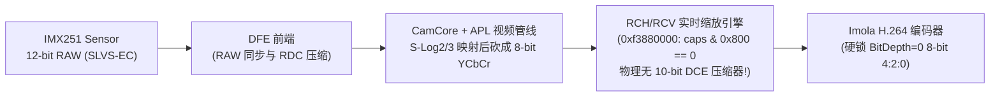
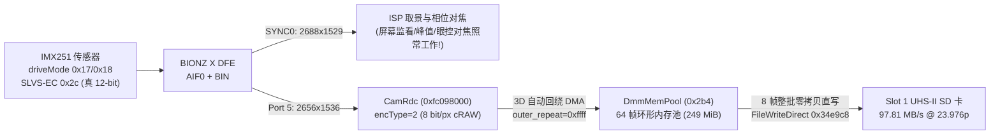

# Sony α7R III (BIONZ X / "Astra") 10-bit 终审与 2.6K 12-bit cRAW 视频直写研究

**[English README -> README_EN.md](README_EN.md)**

> **一句话结论**：
> 1. **传统 4K / 1080p 10-bit MP4 内录在硬件上彻底死刑**：经对 α7R III (`ILCE-7RM3` v3.10) 全套主核/协处理器固件指令级逆向，证实 BIONZ X ("Astra" SoC) 实时视频缩放管线 (`RCH`/`RCV`) 物理缺失 10-bit 块压缩单元 (`caps & 0x800 == 0`)，且后端 `Imola` 视频编码通道锁死 `8-bit 4:2:0`（同平台 α7 III、ZV-E10 一代同理）。
> 2. **绕过 8-bit 视频 ISP 直写 `2.6K 12-bit cRAW` 视频在硅片与卡速上 100% 可行**：前端 `DFE` (`CamAif` + `CamRdc`) 原生具备单通道 **`2656 × 1536`（全画幅视野 16:9，真 12-bit ADC 传感器读出 + 索尼微压 cRAW `encType=2`）** 通路，且硬件内置 **`0xffff` 轮全自动 3D 环形缓冲 DMA**，在 `23.976p` 下码率仅 **`97.81 MB/s`**，单张主流 UHS-II V60 (256GB) / V90 SD 卡即可持续写入，同时完整保留屏幕取景与自动对焦！

本项目开源全部 **6 份芯片级静态逆向分析报告** 与 **Apple Silicon 原生 C 加速（`100+ fps`）的 `A7R3CRAW → CinemaDNG` 达芬奇工作流转换工具**，供影像极客验证画质，并诚邀熟悉索尼 `Astra` / `Jiritsu` 平台底层调试的硬件开发者联手推进测试机实装。

---

## 目录

- [一、为什么传统 10-bit 视频改不出来？（硅片级证伪）](#一为什么传统-10-bit-视频改不出来硅片级证伪)
- [二、破局路线：绕过 ISP 前端直写 2.6K 12-bit cRAW](#二破局路线绕过-isp-前端直写-26k-12-bit-craw)
- [三、IMX251 全部原生视频读出档位与硬件裁切甜点表](#三imx251-全部原生视频读出档位与硬件裁切甜点表)
- [四、快速上手：用你自己的 A7R3 照片实测 2.6K CinemaDNG 视频调色](#四快速上手用你自己的-a7r3-照片实测-26k-cinemadng-视频调色)
- [五、距离实装上机还差什么？（诚邀社区极客协作）](#五距离实装上机还差什么诚邀社区极客协作)
- [六、仓库文档索引](#六仓库文档索引)
- [七、合规与安全声明](#七合规与安全声明)

---

## 一、为什么传统 10-bit 视频改不出来？（硅片级证伪）

长期以来，社区一直猜测索尼第三代机身（α7R III / α7 III / ZV-E10）只是“软件屏蔽了 10-bit 视频”。我们对主固件 `AV-CAM.BIN`（加载基址 `0x635c6000`）、防抖机电协处理器 `bonobo.bin`（Renesas H8S/2600）、数字前端 `dfe_app.bin`（ARMv7）与视频编码微码 `vcd_firmware.bin`（MIPS32 `Imola`）进行了完整交叉逆向（详见 [`docs/04`](docs/04-R3-3.10-SyncYCOut-ISP-hardware.md) 与 [`docs/05`](docs/05-R3-3.10-Bonobo-DFE-and-RCCT-10bit-DCE.md)），证实存在**四重不可逾越的硬件壁垒**：



1. **`bonobo.bin` 不是图像芯片**：它是跑在 Renesas H8S 上的五轴防抖与快门/光圈控制单片机（34 字节串口帧通信），完全不碰视频像素。
2. **实时缩放硅片缺失 10-bit 压缩电路**：全芯片 14 个 `RC`/`DST` 硬件引擎中，负责实时视频缩放的 `RCH_0/1`、`RCV_0/1`（`0xf3880000` / `0xf3980000`）硬件能力掩码 `caps & 0x800 == 0`，物理上没有 10-bit `DCE` 打包器。
3. **中游流水线全 8-bit 硬化**：实时视频主干走 `RC_IP_TYPE_IP (2)` 片上直连，经 `APL`、`Spica` 电子防抖到 `VFX` 全程固定按 8-bit YCbCr 寻址。
4. **编码器通道锁死**：`ImolaCreateCh`（`0x4061bc`）及 4K 规格表（`0x1125d68`）仅实现 8-bit 4:2:0 H.264 通路，无法解码 `DST` 畸变引擎私有的 10-bit 块格式。

---

## 二、破局路线：绕过 ISP 前端直写 2.6K 12-bit cRAW

既然 `CamCore` 之后的视频 ISP 被焊死在 8-bit，唯一的物理生路就是**在图像进入 8-bit 视频管线之前，直接从前端 `DFE` (`CamAif` / `CamRdc`) 把传感器原始 Bayer RAW 压缩抓进 DRAM 环形缓冲池，再顺序直写到 Slot 1 UHS-II SD 卡**（详见 [`docs/06`](docs/06-R3-3.10-2.6K-cRAW-Pipeline-Blueprint.md)）：



### 核心逆向发现（四大工程支柱）：
1. **原生单通道 2.6K 全画幅档位（`SgcParam @ 0x10ffff4`, `driveMode = 0x17 / 0x18`）**：
   - 传感器单端口 `Port 5` 直出 `2656 × 1542`（免双通道拼接、100% 全画幅横向视野、同时保留 `SYNC0` 供屏幕取景与自动对焦），且端口描述符 `0x83cddc` 偏移 `+0x1c` 的**原厂默认编码格式恰好就是 `encType = 2`（索尼微压 cRAW，`1 Byte/pixel`）**！
2. **硬件自带无限自动环形缓冲 DMA（`DFECore::CamAif`, `0x1d06e4` & `0x70a42a`）**：
   - 破解了 `'CamAif:KickRepeat is unsupported.'` 报错——它仅在 `numFrames <= 1` 时拦截；只要分配 `numFrames >= 2`（如从 `DmmMemPool 0x2b4` 划出 64 帧 = `249 MiB`），硬件 3D DMA 自动启用负向回绕步进与 `0xffff`（65,535 轮）外循环，**点一次火即可零 CPU 中断自主运行 48 小时**。
3. **4KB 物理扇区严丝合缝对齐（`2656 × 1536` + `A7R3CRAW` 头）**：
   - 利用 `CamRdc` 窗口裁去边缘 6 行无用黑边定为 **`2656 × 1536`**，单帧精确等于 **`4,079,616 B = 996 × 4096 B`**；配合 `4096 B` 定长 `A7R3CRAW` 自包含文件头，全文件从头到尾 100% 对齐 4KB 页边界，以 **`97.81 MB/s` (23.976p)** 稳稳跑在主流 256GB UHS-II V60 / V90 卡的持续写入安全区内。
4. **现成的达芬奇 CinemaDNG 后期生态**：
   - 硬件 `encType = 2` 采用 32 字节独立分块 + `0x7010` 五段折线映射，经配套工具还原后直接生成带 `ILCE-7RM3` 校准色彩矩阵与白平衡的 `.cinemadng` 视频包，拖入 DaVinci Resolve 即可无损调节色温、ISO 与高光恢复。

---

## 三、IMX251 全部原生视频读出档位与硬件裁切甜点表

除了首选的原生 **2.6K** 外，我们完整解码了 `IMX251` 全部 `SgcParam` 档位及 `CamRdc` 硬件左右裁切器（`lcut` / `rcut`，支持 8 像素步进），各规格在 `encType = 2` (8 bit/px 标准 cRAW) 下的实测带宽如下：

| 目标规格 | 借用传感器原生底座 | `DFE` 硬件裁切 | 画幅视野 | 23.976p 码率 | 存储卡要求与评价 |
| :--- | :--- | :--- | :--- | :--- | :--- |
| **🥇 2.6K 16:9 (`2656 × 1536`)** | `0x17` 原生 `2656×1542` | 仅去 6 行黑边 | **100% 全画幅宽** | **`97.81 MB/s`** | **首选主力档**：单通道免拼、4KB 对齐、主流 256G V60 (`150MB/s W`) 即可无限长录 |
| **2.6K 宽银幕 (`2656 × 1022`)** | `0x26` 原生升格档 | 免裁切 | 全画幅 2.54:1 | **`65.08 MB/s`** | 入门 V60 卡毫无压力；开启 60p 也仅 `162.7 MB/s` (V90) |
| **3.2K 16:9 (`3200 × 1800`)** | `0x00` 全幅 `4032×2277` | 左右各切 `416 px` | 1.20× 微裁切 | **`138.10 MB/s`** | 需高速 UHS-II V90 卡（临界安全线内） |
| **3.7K 电影宽幅 (`3680 × 1536`)** | `0x00` 全幅 `4032×2277` | 左右各切 `176 px` | **1.04× 近全幅宽** | **`135.52 MB/s`** | 2.39:1 电影宽银幕甜点，V90 卡可录 |
| **4.0K 全画幅 (`4032 × 2277`)** | `0x00` 原生全幅 4K | 免裁切 | 100% 全画幅 | `220.07 MB/s` | 8bpp 超出机身 SD 卡槽上限（唯有改用 `encType=1` 4bpp 重压至 `110 MB/s` 才可落盘） |

---

## 四、快速上手：用你自己的 A7R3 照片实测 2.6K CinemaDNG 视频调色

无需任何第三方 Python 依赖（macOS 自带 `clang` 会自动编译原生 C 加速库，实测转换速度 **`100+ fps`**）。只需准备任意一张你用 A7R3 拍摄的**“已压缩 RAW (`.ARW`)”**照片，即可在本地体验完整的 **模拟采集 → 极速解包 → 达芬奇调色** 流程：

```bash
# 1. 从你的真实 A7R3 压缩 ARW 照片中无损切出 24 帧（1秒平滑摇镜）的方案 A 硬件裸流 MOV00001.CRAW
python3 tools/a7r3_26k_craw_unpacker.py simulate \
  --donor-arw /path/to/your/DSC00001.ARW \
  --output ./MOV00001.CRAW

# 2. 极速解包还原为达芬奇原生识别的 .cinemadng 14-bit 线性容器视频包（Apple Silicon 约 0.2 秒完成！）
python3 tools/a7r3_26k_craw_unpacker.py unpack \
  --input ./MOV00001.CRAW \
  --output-dir ./MOV00001.cinemadng
```

**导入 DaVinci Resolve 调色提示**：
1. 直接将生成的 **`MOV00001.cinemadng` 整个文件夹包裹** 拖入达芬奇媒体池（切勿点进文件夹单选 `.dng` 图片），即可识别为一条 `23.976 fps` 动态 RAW 视频。
2. 在【调色】页面左下角打开 **摄影机原始资料（Camera RAW）**，将“解码使用”设为 **片段（Clip）**：
   - 想快速直出：色彩空间与 Gamma 选 `Rec.709` 并适当增加对比度；
   - 想走电影工业宽容度流程：色彩空间选 `Blackmagic Design` / `Blackmagic Design Film`，再挂载 `CST` 色彩空间转换节点还原。

---

## 五、距离实装上机还差什么？（诚邀社区极客协作）

目前我们已完成**全部离线架构求证、寄存器映射与后期工具链闭环**。距离在测试机上真正按下录制键跑起来，还需要以下领域的开发者接力合作：

- [x] 证伪传统 `SyncYCOut -> RCCT -> Imola` 10-bit 视频路径（避免继续在死胡同耗费精力）
- [x] 逆向定位 `IMX251` 全部 `SgcParam` 档位、`CamRdc` 物理基址 (`0xfc098000`) 与 `DFECore::CamAif` 自动 3D 环形 DMA (`0x70a42a`)
- [x] 逆向定位 RTOS `DmmMemPool` (`0x2b4`) 物理大内存分配与 `FileWriteDirect` (`0x34e9c8`) 零拷贝写盘接口
- [x] 制定 4KB 扇区对齐的 `A7R3CRAW` v1 格式规范并完成 Mac 端 `100+ fps` CinemaDNG 解包工具
- [ ] **【待补充静态图纸】**：逆向 `Sequence_Movie.cpp` 录制状态机切入点与 `mcLpcmBuffMgr.cpp` 机内 48kHz 双声道 `.WAV` 同步录音保存逻辑
- [ ] **【核心招募：测试机执行入口】**：寻找熟悉索尼第三代 `Astra` SoC / `Jiritsu` Linux ↔ RTOS (`AV-CAM`) 核间通信、且手头备有 **接好硬件 UART 串口的报废/测试用 α7R III 或 α7 III 主板** 的安全硬件研究者，在工程测试环境下验证 RTOS 内存钩子与连续写卡热稳定性。

欢迎提交 Issue 或 Pull Request 交流探讨！

---

## 六、仓库文档索引

| 文档路径 | 内容摘要 |
| :--- | :--- |
| [`docs/01-R3-3.10-REC-0x36-closure.md`](docs/01-R3-3.10-REC-0x36-closure.md) | `StdYcInfo +0x36` (`bit_depth`) 全局零写入追踪闭环 |
| [`docs/02-R3-3.10-10bit-patch-feasibility.md`](docs/02-R3-3.10-10bit-patch-feasibility.md) | `Imola` 编码器参数槽位审计与早期单点补丁不可行性评估 |
| [`docs/03-R3-3.10-0x1e-VBB-AVC-closure.md`](docs/03-R3-3.10-0x1e-VBB-AVC-closure.md) | 主核与 `vcd_firmware` 间 `0x1e` IPC 消息与 `VBB RX` 格式表解析 |
| [`docs/04-R3-3.10-SyncYCOut-ISP-hardware.md`](docs/04-R3-3.10-SyncYCOut-ISP-hardware.md) | `SyncYCOut` 源头定位与 BIONZ X ISP 硬件 `DCE` 能力初探 |
| [`docs/05-R3-3.10-Bonobo-DFE-and-RCCT-10bit-DCE.md`](docs/05-R3-3.10-Bonobo-DFE-and-RCCT-10bit-DCE.md) | **`bonobo`/`dfe` 协处理器真身揭秘与全芯片 14 路 `RC`/`DST` 实时 10-bit 终审否决报告** |
| [`docs/06-R3-3.10-2.6K-cRAW-Pipeline-Blueprint.md`](docs/06-R3-3.10-2.6K-cRAW-Pipeline-Blueprint.md) | **方案 A：`2.6K (2656×1536)` 12-bit cRAW 硬件自动环形直写管线完整工程蓝图** |
| [`tools/a7r3_26k_craw_unpacker.py`](tools/a7r3_26k_craw_unpacker.py) | `A7R3CRAW` 流模拟生成与 `100+ fps` 原生 C 加速 CinemaDNG 解包工具 |

---

## 七、合规与安全声明

1. **零原厂固件代码**：本仓库仅包含独立撰写的静态硬件架构分析笔记与原创后期转换代码，**不包含任何受版权保护的索尼固件镜像、二进制切片或密钥**。
2. **禁止用于生产主力机刷机**：本仓库不提供任何绕过固件数字签名、越狱提权或修改刷机包的工具与教程。切勿尝试向正常使用的相机刷入任何非官方数据，否则极易导致设备永久损坏（变砖）。
3. 本项目采用 [MIT License](LICENSE) 开源。
