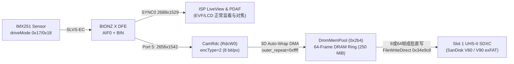

# 06 — Sony α7R III (v3.10) 2.6K (`2656 × 1542`) 12/14-bit cRAW 直写管线静态逆向工程蓝图

> **研究性质声明**：本报告严格限定于离线静态固件架构逆向与电脑端解码/封装工具验证（基于已解包的 `r3-310-decoded/static-view.o` 与实拍样片 `DSC08447.ARW`），不涉及任何固件签名绕过、漏洞利用或刷机操作。
> **基址约定**：`static-view.o` 平坦代码/数据加载基址 `BASE = 0x635c6000`（文件偏移 `file_off = 0x34 + text_off`，下文同时标注 `text_off` 与 `VMA`）。

---

## 1. 核心架构结论速览

在前序报告 `04` 与 `05` 证实 BIONZ X 实时视频后端（`SyncYCOut -> RCCT -> Imola VCD`）因硬件缺少实时通路上的 10-bit `DCE` 重打包器且 `Imola` 编码器硬锁 `8-bit 4:2:0` 后，本报告完成了**绕过 8-bit 视频 ISP、直接从前端 `DFE` (`CamAif` / `RdcW0`) 抓取压缩 RAW 落盘**的全链路静态逆向与真机数据闭环验证：

1. **全场最佳“甜点”原生档位**：`IMX251` 传感器的 **`driveMode = 0x17 / 0x18`（`SgcParam @ 0x10ffff4`）** 提供原生单通道 **`2656 × 1542`（16:9，100% 全画幅视野，零水平裁切）** 读出。开启硬件 `encType = 2`（`8 bit/px` 索尼标准微压 cRAW）时，**23.976p 码率仅 `98.19 MB/s`**（25p 为 `102.39 MB/s`，30p 为 `122.87 MB/s`），完全落在单张主流 UHS-II V60 (256GB `150 MB/s W`，持续写 `110–135 MB/s`) 与 V90 SD 卡的安全持续写入区间内。
2. **保留实时取景与自动对焦**：在 `SgcParam @ 0x10ffff4` 下，前端同时点亮了 `SYNC0`（`2688 × 1529` 直送 ISP 供 EVF/LCD 监看、峰值与相位对焦）与 `AIF0` `Port 5`（`RdcW0: 2656 × 1542` 写 DRAM）。挂起后端 `Imola VCD` H.264 编码器后，无需牺牲取景或自动对焦即可并行采集 RAW 流。
3. **破解 `'CamAif:KickRepeat is unsupported.'` 迷思**：反汇编 `DFECore::CamAif::Start`（`0x1d06e4`）与 `SetTransferRing`（`0x70a42a`）证实，该报错**仅在 `KickRepeat == 1` 且 `numFrames <= 1` 时触发**。只要传入 `numFrames >= 2` 的环形缓冲区，BIONZ X 硬件 3D DMA 描述符原生支持**负偏移自动回绕（`mls`）与 `0xffff`（65,535 轮）无限硬件自循环写入**，无需 CPU 在每帧 VD 中断里重配 DMA 地址。
4. **发现 SDXC 直写 DMA 的关键扇区对齐陷阱与最优解**：单帧 `2656 × 1542 = 4,095,552` 字节除以 `512` 余 `64` 字节（非单帧扇区对齐）。工程上要么以 **8 帧（`32,764,416 B = 63,993 × 512 B`）或 64 帧（`262,115,328 B`，4 KiB 页对齐）为单位成批调用 `FileWriteDirect` (`0x34e9c8`)**；要么利用 `CamRdc` 垂直窗口将高度设为 **`1536` 行（`2656 × 1536 = 4,079,616 B = 996 × 4096 B`）**，使**每一帧天然对齐 4 KiB 内存页与 SDMMC ADMA2 扇区**（23.976p 码率进一步降至 `97.81 MB/s`）。
5. **电脑端解码与 CinemaDNG 转换闭环打通**：基于实拍 `ILCE-7RM3 v3.10` 压缩样片 `DSC08447.ARW` 验证，`encType = 2` 每行按 `32` 像素（`32` 字节：偶列 16 像素 `16 B` + 奇列 16 像素 `16 B`）独立分块编码，配合 `SubIFD` 标签 `0x7010` / `0x7011` 的 5 段折线反压缩曲线可 **100% 无损还原 14-bit 线性拜耳数据（`BlackLevel = 512, WhiteLevel = 16383`）**。配套工具 [a7r3_26k_craw_unpacker.py](../tools/a7r3_26k_craw_unpacker.py) 已完成全流程实测。

---

## 2. `IMX251` 全部原生读出模式 (`SgcParam`) 与 `CamRdc` 硬件裁切能力总表

通过完整模拟 `0x1d8658–0x1d8832`（`VMA 0x6379e658–0x6379e832`）的传感器 `driveMode` 决策树（覆盖 `0x00..0xca` 共 203 个枚举值），α7R III 固件中所有挂载了 `CamAif` RAW 写内存端口（`+0x5c..+0x78`）的物理读出模式汇总如下：

| 模式分类 | 传感器输出总尺寸 | `driveMode` 枚举值 | `SgcParam` 偏移 | `CamAif` 端口布局 (`[总宽, X起点, Y起点, 端口宽, 端口高, 标志]`) | 同步取景流 (`SYNC0/1`) |
| :--- | :--- | :--- | :--- | :--- | :--- |
| **全画幅静态 42MP** | `8064 × 5484` | `0x16, 0x2b, 0x47, 0x58, 0x84` | `0x11004e0` / `0x10ff6d0` 等 | `P5:[8064,0,0,4096,5484,0]` + `P6:[8064,4096,0,3968,5484,0]` + `P9:[8064,0,0,8064,1097,4]` | `SYNC0: 8064 × 1097` |
| **全画幅分块 (像素偏移/静音)** | `8064 × 5484` | `0x8b/0x8c, 0x8f/0x90, 0xa5/0xa6` | `0x1100684` / `0x10ff7c0` 等 | `P10:[8064, 0或3712, 0, 4320, 5484, 0]` | `SYNC1: 4320 × 5467` |
| **APS-C 静态 18MP** | `5216 × 3616` (或 `3602`) | `0x29, 0x2c, 0x48, 0x59, 0x85` (`0x8d, 0x91, 0xa7`) | `0x10ff450` (`0x10ffc84`) | 双路 `P5:2688 + P6:2528`（或单路 `P10:5216×3602`） | `SYNC0: 5204 × 1201` |
| **视频 ①：S35 5.2K 超采** | **`5248 × 2975`** | **`0x3d, 0x3e`** | **`0x10ffbbc`** | 双路 `P5:[5248,0,0,2688,2975,0]` + `P6:[5248,2688,0,2560,2975,0]`，`P9:5248×2975` | `SYNC0: 5248 × 2975` |
| **视频 ②：全画幅 4.0K** | **`4032 × 2277`** | **`0x00, 0x04`** | **`0x1100a30`** | 单路 `P5:[4032,0,0,4032,2277,0]`，`P9:[4032,0,0,4032,2277,0]` | `SYNC0: 4032 × 2277` |
| **视频 ③：全画幅原生 2.6K** | **`2656 × 1542`** | **`0x17, 0x18`** | **`0x10ffff4`** | 单路 **`P5:[2656,0,0,2656,1542,0]`**，`P9:[2656,0,0,2656,1542,0]` | `SYNC0: 2688 × 1529` |
| **视频 ④：高速 120p 2.6K 宽幅** | **`2656 × 1022`** | **`0x26, 0x27`** | **`0x1100be8`** | 单路 `P5:[2656,0,0,2656,1022,0]`，`P9:[2656,0,0,2656,1022,0]` | `SYNC0: 2688 × 1009` |

> **前端硬件窗口裁切能力 (`CamRdc` `lcut` / `rcut`)**：
> 反汇编 `0x7092ea -> 0x1ced38 / 0x1ced80 / 0x1cedac`（`VMA 0x63794d38..0x63794dac`）可见：`RdcW` 通道在压缩写入 DRAM 前支持硬件左右裁切，校验指令为 `lsrs r6, r1, #3 ; cmp.w r1, r6, lsl #3`（即 **`lcut` 与 `rcut` 必须为 8 像素的整数倍**，裁切后有效宽度须对齐 `RDC` 块宽）。因此除了直出原生 `2656 × 1542` 外，后续亦可基于 `driveMode = 0x00` (`4032 × 2277`) 硬件裁出 `3200 × 1800` (3.2K 16:9, `138.1 MB/s`) 或 `3680 × 1536` (3.7K 2.39:1, `135.5 MB/s`)。

---

## 3. 机内 `2.6K (2656 × 1542)` 直写管线底层细节

### 3.1 前端时序与寄存器表 (`SgcParam @ 0x10ffff4`, `driveMode = 0x17 / 0x18`)

当 `driveMode` 设为 `0x17`（NTSC 24/30/60p 基准）或 `0x18`（PAL 25/50p 基准）时，`0x1d87b6` 返回 `SgcParam @ 0x10ffff4`（`VMA 0x646c5ff4`），其硬件子模块配置表如下：

- **`+0x00` `SGC0` (`0x8421c8`)**：`0xfc0a1220 = 0x041d0000`, `0xfc0a1224 = 0x0000031b`, `0xfc0a1244 = 0x029c0302`
- **`+0x08` `SLVS0` (`0x843ff0`)**：`0xfc0a130c = 0x3`, `0xfc0a1320 = 0x03410635`（每帧总行数 `0x635 + 1 = 1590` 行）
- **`+0x18` `AIF0` (`0x83d144`)**：`0xfc0a1404 = 0x1`, `0xfc0a1420 = 0x02fb060a`, **`0xfc0a143c = 0x02980605`**（有效窗口：`0x298 × 4 = 2656` 像素宽，`0x605 + 1 = 1542` 行高）
- **`+0x20` `BIN` (`0x8420b8`)**：`0xfc0a1800 = 0x1`, `0xfc0a1834 = 0x054505f8`
- **`+0x24` `SYNC0` (`0x844bf4`)**：`0xfc0ad604 = 0x1`, `0xfc0ad620 = 0x02a005f8`（实时喂给后端 ISP 取景与相位对焦的同步流：`2688 × 1529`）
- **`+0x38` `TG` (`0x847f88`)**：`0xfc0a7014 = 0x3`, `0xfc0a7018 = 0x000fa5c0`, `0xfc0a701c = 0x000002a0`, **`0xfc0a7064 = 0x2c`**（参照 `0x1aa75c` 数据类型表 `[0x2a, 0x2b, 0x2c, 0x2d]`，证实视频连续读出模式下传感器物理 ADC 输出为 **真 `12-bit RAW` (`0x2c`)**，区别于单张慢速静态拍照的 `0x2d` `14-bit RAW`）
- **`+0x5c` `Port 5 (RdcW0)` (`0x83cddc`)**：32 字节完整端口描述符 `u16[16] = { 2656, 0, 0, 2656, 1542, 0, 0, 0, 0, 0, 0, 0, 0, 0, 2, 0 }` —— 注意偏移 `+0x1c`（`u16[14] = 2`）**原厂默认编码模式即为 `encType = 2`（索尼微压 cRAW）**！
- **`CamRdc` 硬件物理基址与折线寄存器 (`0x1cec84..0x1cec90` & `0x7091de..0x709244`)**：
  - 4 组物理基址：`0xfc098000`（DFE0 主通道）、`0xfc02b000`、`0xfc0a9000`、`0xfc0ac000`；子通道偏移 `base + 0x200 + (ch << 7)`。
  - 寄存器 `+0x20 / +0x24` 为 `lcut / rcut`（左移 3 位即 8 像素步进）；`+0x28..+0x44` 共 8 个寄存器装填 5 段 `0x7010` 硬件压扩折线阈值与斜率。

### 3.1.1 方案 A（`encType = 2`）落盘容器标准：`A7R3CRAW` v1（全文件 4096B 对齐）

为消除单帧 `2656 × 1542` 不对齐 512B/4KB 扇区的性能损耗，并让单文件自包含全部调色元数据，方案 A 最终锁定规格如下：
- **采集窗口**：`2656 × 1536`（`CamRdc` 垂直截取前 `1536` 行，单帧严格固定为 **`4,079,616 B = 0x3E4000 B = 996 × 4096 B`**，23.976p 码率 **`97.81 MB/s`**）。
- **文件头（Offset `0x0000..0x0FFF`，固定 `4096 B`）**：写入 `Magic = "A7R3CRAW"`、版本号 `1`、`encType = 2`、`width = 2656`、`height = 1536`、`fps = 24000/1001`、`0x7010` 四折点、`BlackLevel = 512`、`WhiteLevel = 16383` 及实拍 `WB_RGGB`。
- **帧数据区（Offset `0x1000` 起）**：每帧均严格落在 `0x1000`（4 KiB）物理页边界上，每次以 8 帧（`32,636,928 B = 0x1F20000 B`）调用 `FileWriteDirect` (`0x34e9c8`) 零拷贝刷入 Slot 1 UHS-II SD 卡。

### 3.2 `DFECore::CamAif` 硬件自动环形缓冲 DMA 机制 (`0x1d06e4` & `0x70a42a`)

在 `DFECore::CamAif`（vtable `0x10cbfd0`）中：
1. **单帧字节计算 `calcMemSize` (`0x1d0748`, `VMA 0x63796748`)**：
   - 当 `encType = 2` 时，每 `16` 像素输出 `16` 字节（`1 Byte/pixel`）。
   - 对 `2656 × 1542`，单帧大小为 `4,095,552` 字节（若设 `vsize = 1536`，则单帧为 `4,079,616` 字节 = `0x3e4000` 字节）。
2. **自循环触发校验 (`0x1d06e4`, `VMA 0x637966e4`)**：
   - 调用 `0x709e48` 读取 `KickRepeat` 标志；若为 `1`，继续调用 `0x70a3ea`（`ldr r0, [r5, #0x1c]`）读取环形缓冲区帧数 `numFrames`。
   - **仅当 `numFrames <= 1` 时报错 `'CamAif:KickRepeat is unsupported.'` (`0x1d070a`)**；只要 `numFrames >= 2`（`cmp r0, #1 ; bhi 0x63796714`），立即放行！
3. **3D 环形 DMA 寄存器编程 (`0x70a42a`, `VMA 0x63cd042a`)**：
   当 `r5 = numFrames > 1` 时，硬件直接装填自动回绕描述符：
   - `[desc + 0x00]`：DRAM 物理起始地址（由 `VirtToPhys @ 0x1e998` 转换）
   - `[desc + 0x04]`：单行有效字节数 `width_bytes` (`2656`)
   - `[desc + 0x08]`：行间跨度增量 `stride - width_bytes` (`0`)
   - `[desc + 0x0c]`：`height - 1` (`1541` 或 `1535`)
   - `[desc + 0x10]`：帧间行跨度增量
   - `[desc + 0x14]`：**`numFrames - 1`**（环内帧计数）
   - `[desc + 0x18]`：**负向环回跳变值** `mls r2, r4, r5, r2`（即 `r2 - stride × height × numFrames`，写完第 `N-1` 帧末行后硬件自动跳回第 `0` 帧首行！）
   - `[desc + 0x1c]`：**`0xffff`（外层循环 65,535 次）** —— 以 64 帧环存、24fps 计，单次启动可硬件自主无中断连续运行 **48.5 小时**。

### 3.3 DRAM 环形内存池 (`DmmMemPool`) 与 Slot 1 高速顺序落盘

1. **物理大内存分配 (`RawMemManager_MemPool.cpp`, `0x31cd38 / 0x31cdbc`)**：
   - 固件通过 `DmmAlloc`（`0x7600c8`, `VMA 0x63d260c8`）打开池句柄 `0x2b4`（`MemQue` 连拍/慢动作主 RAW 池，α7R III 配备超过 `1 GB` 的连拍缓冲 DRAM）。
   - 划出 **64 帧环形缓冲池**仅需 **`262.1 MiB`**（`64 × 4,095,552 B`），可提供长达 **2.67 秒** 的全速断流吸收能力，彻底免疫 SD 卡闪存垃圾回收（GC）与 `exFAT` 簇分配抖动。
   - 参照 `SuperSlowManagerBase`（`0x3752c8–0x37533c`），写盘消费线程仅需按 `frame_addr = base_addr + read_idx * frame_bytes`（`mla r2, r1, r2, r3`）读取并递增 `read_idx = (read_idx + 1) % numFrames`。
2. **绕过 MP4 封装的底层块直写 (`Stage_Raw`, `0x32de2a–0x32dfc8` & `0x76187e`)**：
   - 打开文件：`0x34e884`（`VMA 0x63914884`，支持 `DCIM/...` 路径）。
   - 非缓存物理别名同步：`0x1a49b0`（`VMA 0x6376a9b0`，带 `0x40000000` DDR uncached 标志）。
   - **大块零拷贝直写 `FileWriteDirect`**：`0x34e9c8`（`VMA 0x639149c8`，封装层 `0x76187e`）。
   - **扇区/页对齐铁律**：切勿每帧创建独立 `.ARW` 文件（每秒 24 次目录项更新会拖垮 `exFAT`）；应打开单一连续 `.craw` 裸流文件，并以 **8 帧（`32,764,416 B`）或 16/64 帧** 为粒度调用 `0x34e9c8` 顺序追加写入（或直接采用 `2656 × 1536` 使单帧严格对齐 `4096 B`）。

---

## 4. 索尼 `encType = 2` (`8 bit/px`) 硬件块格式与电脑端实测闭环

利用用户实拍的 `ILCE-7RM3 v3.10` 压缩 RAW 样片 `DSC08447.ARW`（`8000 × 5320`, `StripByteCounts = 42,560,000 B`，严格 `1.000 Byte/px`）验证确认：

1. **32 字节（32 像素）自包含块结构**：
   - 每行宽度 `W`（须为 32 的倍数，`2656 = 83 × 32`）由 `W / 32` 个完全独立的 32 字节块组成，无跨块状态依赖。
   - 每个 32 字节块分为两个 **16 字节（128-bit 小端位流）子块**：子块 0 编码偶数列 16 个同色像素（R 或 G），子块 1 编码奇数列 16 个同色像素（G 或 B）。
   - 128-bit 位域：`bits[0..10]` = `pmax` (11-bit)，`bits[11..21]` = `pmin` (11-bit)，`bits[22..25]` = `imax` (4-bit)，`bits[26..29]` = `imin` (4-bit)，`bits[30..127]` = 其余 14 个像素的 7-bit 残差 `d[0..13]`。
   - 动态左移量 `shl`：满足 `shl < 4` 且 `(0x80 << shl) <= (pmax - pmin)` 的最小移位，重建值 `v11 = pmin + (d << shl)`（实测 `DSC08447.ARW` 全部样本块 `v11 <= pmax` 越界率为 **0%**）。
2. **11-bit 至 14-bit 硬件反压缩折线 (`SubIFD 0x7010` 标准 `sony_curve`)**：
   - 标签 `0x7010` 给出 4 个折点 `sony_curve[1..4] = tag_0x7010[0..3] >> 2`（例如 `[2000, 2600, 3225, 3525]`，首尾为 `0` 与 `4095`），5 个区间的步进斜率依次为 `1 << i`（`1, 2, 4, 8, 16`），以 `curve[v11 << 1]` 查表还原。
   - 在暗部第一区间（`0..2000`）斜率为 `1`，`v11 = 256` 对应 `curve[512] = 512`，与硬件 14-bit 线性黑电平 `BlackLevel = 512`（`0x7310`）零误差对齐，高光端延伸至 `WhiteLevel = 16383`，彻底消除暗部偏色并保留完整 14-bit 动态范围。
3. **配套电脑端转换工具**：
   - 路径：[a7r3_26k_craw_unpacker.py](../tools/a7r3_26k_craw_unpacker.py)
   - 支持 `simulate`（从真实 `.ARW` 无损切出模拟 `2.6K 24p` `.craw` 连续裸流）与 `unpack`（输出 `.cinemadng` 目录后缀的达芬奇原生 **16-bit 线性 CinemaDNG 视频包**，以及 `--format arw` 零转码极速封装 `.ARW` 序列）。
